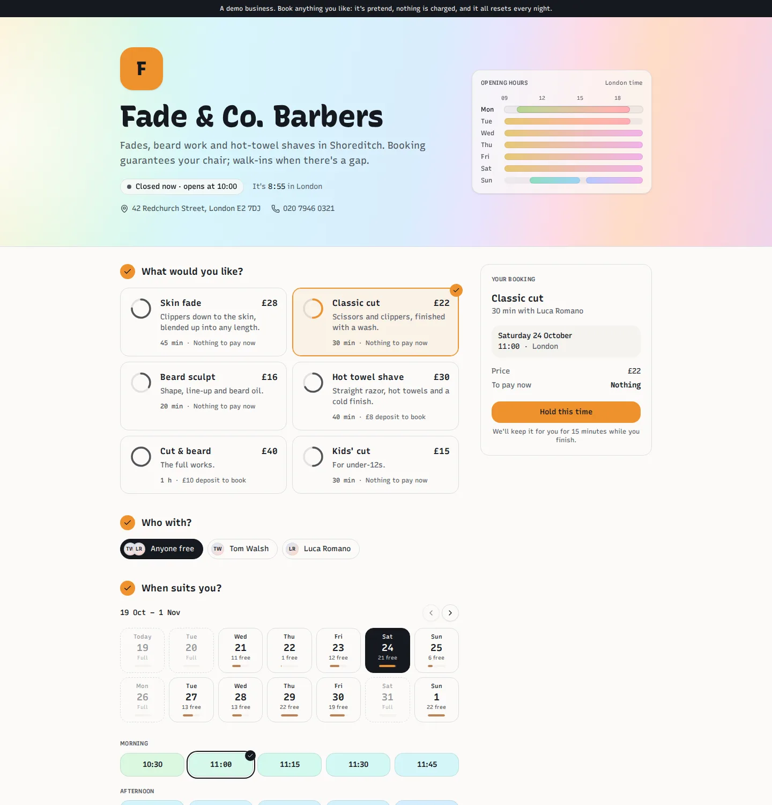
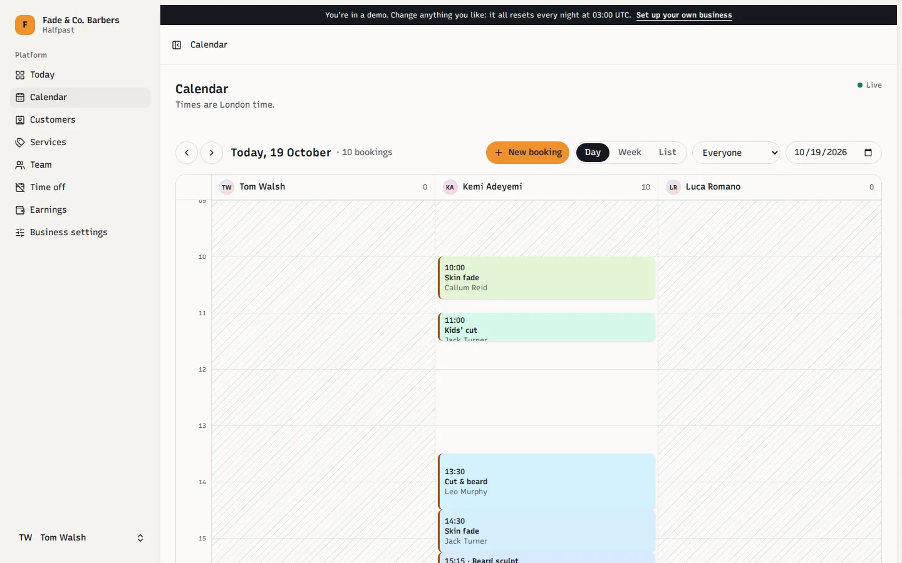
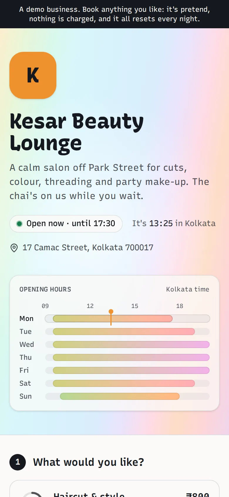
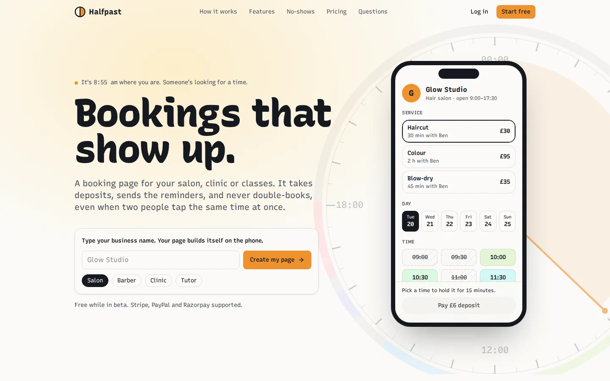

# Halfpast

Booking pages for small businesses (salons, barbers, clinics, tutors) that take deposits, send reminders and can't double-book, even when two customers tap the same time in the same second.



A business signs up, adds its services, team and hours, and gets a page at its own address (`/fade-and-co`). Customers pick a service, a person (or anyone free), a day and a time; the time is held while they pay a deposit; then they get a confirmation with a calendar file and reminders 24 and 2 hours before. The business runs its day from a live calendar.

It's a portfolio project, so payments run in **test mode**: no real money moves. Three demo businesses come with it, with one-click logins (see [The demo](#the-demo)).

## What it does

**For a business**

- A booking page with its logo, description, address, a live "open now" and its week's opening hours.
- Services with prices and deposits (none, fixed or a percentage), and who offers each one.
- The team's weekly hours (split shifts and breaks included), time off and whole-business closures.
- Booking rules: notice needed, how far ahead, slot spacing, how long a picked time is held, and the cancellation window.
- A day, week and list calendar that updates live as bookings arrive, plus manual bookings and blocked-out time.
- Booking details with a full history; mark completed or no-show, or cancel with or without a refund.
- Customers with their history and private notes, and earnings per payment provider.
- Stripe, Razorpay and a built-in test gateway; download everything as spreadsheets, or delete it all.

**For a customer**

- Times in their own time zone, with the business's named; the picked time held with a visible countdown.
- A deposit taken on the payment provider's own page; a confirmation email with a calendar file and a link to view or cancel.
- Cancelling outside the window refunds the deposit automatically; inside it, the business keeps it, and the page says which before they confirm.

**For whoever runs it**

- An admin of every business, booking and payment, the webhook log and failed jobs; Horizon for the queue and Pulse for slow requests, slow queries and errors; an email when a job fails for good.

<p>


</p>

## How it's built

- **No double bookings, guaranteed by the database.** A booking takes a range of someone's time, and a PostgreSQL exclusion constraint refuses any overlap. A held time is a booking that lapses. When several customers hold the same time at once, an advisory lock on that person's diary queues them, so exactly one gets it and the rest are told "just taken". A test forks 20 processes that all hold the same slot at the same moment. See [`HoldTime`](app/Actions/Booking/HoldTime.php) and [`HoldRaceTest`](tests/Concurrency/HoldRaceTest.php).
- **Time zones and daylight saving.** Weekly hours are local clock times; bookings are real moments in UTC. The slot finder in [`app/Availability`](app/Availability) turns one into the other date by date, and the tests cover the nights the clocks change (when 01:00 happens twice) and half-hour offsets like India's.
- **One database, many businesses.** Every business-owned table carries `business_id` behind a global scope that's set before route model binding, and the tests ask for other businesses' records and expect a 404.
- **Payments behind one interface.** Stripe, Razorpay and the test gateway share one contract. Webhooks are verified, stored, and processed once, however many times they arrive; a check every minute settles any payment nobody heard back about; refunds retry; every payment and refund goes into a ledger per business. See [`app/Payments`](app/Payments).
- **Server rendering without hydration mismatches.** Public pages arrive as HTML. The server can't know a visitor's language, time zone or clock, so a page starts from the business's zone and a fixed locale (the home page's clock from half past three), then switches to the visitor's own once it's running. See [`hydration.ts`](resources/js/lib/hydration.ts).
- **A design system computed from the hour.** Every time slot is tinted by the hour it starts at, blended in OKLCH between six fixed colours, from dawn rose to evening violet. The same ramp is in TypeScript and PHP, so link previews, error pages and emails are drawn from it too. Each booking page's share picture is the business's working day in those colours.
- **Live updates.** Calendars listen on a private Reverb channel; a booking change broadcasts once its transaction commits.
- **Ready for production.**
    - Security: a content security policy with nonces, signed links for customers, two-factor sign-in and rate limits.
    - Running it: Horizon, Pulse, a scheduler heartbeat behind `/up`, daily logs, containers that restart themselves, and designed error and maintenance pages.
- **Tested.** Around 585 Pest tests, including the concurrency race, plus PHPStan at level 7, vue-tsc, ESLint and Prettier. CI runs all of them, and audits the dependencies, on every push.


## Running it locally

All you need is Docker (Docker Desktop on macOS or Windows, Docker Engine with the Compose plugin on Linux) and `make`. PHP, Composer, Node and the database all run inside containers, so nothing else has to be installed.

```bash
git clone git@github.com:prabhjotsingh265/halfpast.git
cd halfpast
make setup
```

`make setup` builds the image, installs the PHP and JavaScript dependencies, creates `.env`, runs the migrations and adds three demo businesses. When it finishes:

| Address                                   | What's there                                    |
| ----------------------------------------- | ----------------------------------------------- |
| http://localhost:8000                     | The app                                         |
| http://localhost:8000/kesar-beauty-lounge | A demo salon's booking page                     |
| http://localhost:5173                     | Vite dev server (hot reload)                    |
| http://localhost:8025                     | Mailpit, which catches every email sent locally |
| ws://localhost:8080                       | Reverb, which sends live calendar updates       |

### The demo



The home page tells a day at a salon in one scroll, with two customers going for the same time. Then try it yourself: the login page has one-click logins into three demo businesses, each with a few weeks of bookings, payments and customers around today:

| Business            | Where, in         | Booking page           | Logins                                                      |
| ------------------- | ----------------- | ---------------------- | ----------------------------------------------------------- |
| Kesar Beauty Lounge | Kolkata, rupees   | `/kesar-beauty-lounge` | `demo@halfpast.test` (owner), `staff@halfpast.test` (staff) |
| Fade & Co. Barbers  | London, pounds    | `/fade-and-co`         | `barber@halfpast.test` (owner)                              |
| Stillwater Physio   | New York, dollars | `/stillwater-physio`   | `clinic@halfpast.test` (owner)                              |

Every password is `password`. With `DEMO_MODE=true`, they're rebuilt every night at 03:00 UTC; `make demo` does it now. Demo logins can't change how they sign in, demo businesses don't send emails the business would send, and their deposits go through the built-in test gateway.

Open the calendar in two windows and add a booking in one: it appears in the other within a couple of seconds.

### The platform admin

`/admin` shows every business, booking and payment, the webhook log and failed jobs (which can be retried or cleared). Locally, log in as `admin@halfpast.test` / `password`. Anywhere else, let someone in with `php artisan admin:grant them@example.com` (and `--revoke` to undo). Admins sign in through the normal login, two-factor included.

The queue runs on [Horizon](https://laravel.com/docs/horizon); its dashboard is at `/horizon`, for admins only. [Pulse](https://laravel.com/docs/pulse) at `/pulse` (admins only) shows slow requests (over 500 ms), slow queries (over 100 ms), exceptions, slow jobs and who's busiest, for the last 7 days. If a job fails for good, the admins get an email (once an hour at most for each kind of job). After deploying new code, run `php artisan horizon:terminate` inside the `queue` container (`docker compose exec queue php artisan horizon:terminate`); Docker starts it again on the new code.

On Windows, run the commands from a WSL 2 terminal.

## Payments in test mode

Deposits can be taken through Stripe and Razorpay (PayPal is on the way). Without any keys, a built-in test gateway is used, so the whole flow works out of the box.

To use the real gateways in test mode, add their **test** keys to `.env`. Never commit them:

| Setting                                  | Where it comes from                                            |
| ---------------------------------------- | -------------------------------------------------------------- |
| `STRIPE_KEY`, `STRIPE_SECRET`            | Stripe Dashboard → Developers → API keys (test mode)           |
| `RAZORPAY_KEY_ID`, `RAZORPAY_KEY_SECRET` | Razorpay Dashboard → Account & Settings → API keys (test mode) |

Then switch them on under **Business settings → Payment methods**.

- **Stripe webhooks, locally:** `make up` starts Stripe's CLI by itself when the Stripe keys are in `.env`. It saves the signing secret and forwards test webhooks to the app. `make stripe-webhooks` does the same on its own.
- **Razorpay webhooks** need a public address, so locally the app settles Razorpay payments when the customer returns, and a check runs every minute for any it hasn't heard back about.

Test details:

- **Stripe:** card `4242 4242 4242 4242`, any future date, any CVC.
- **Razorpay:** Netbanking, any bank, then **Success** on the test bank page.

### Maintenance mode

`php artisan down --render="errors::503" --retry=60` shows the designed "Back in a few minutes" page while you work; `php artisan up` brings the site back. Every error page (404, 403, 419, 429, 500, 503) is self-contained, with no scripts or built assets, so it still renders when the app is what's broken.

## Everyday commands

| Command                       | What it does                                  |
| ----------------------------- | --------------------------------------------- |
| `make up` / `make down`       | Start or stop every container                 |
| `make test`                   | Run the test suite                            |
| `make lint`                   | Check code style and run static analysis      |
| `make shell`                  | Open a shell in the app container             |
| `make artisan c="route:list"` | Run any artisan command                       |
| `make fresh`                  | Rebuild the database from scratch and seed it |
| `make logs`                   | Follow the logs of every container            |

`make help` lists the rest.

## Stack

PHP 8.4 · Laravel 13 · Vue 3 and TypeScript through Inertia 3 · Vite 7 · Tailwind CSS 4 · PostgreSQL 17 · Redis 8.2 · FrankenPHP · Docker

Every dependency is on a release line with a track record that's still supported: no pre-1.0 packages and no brand-new major versions.

### Server rendering

The public pages (the home page, every booking page, the privacy policy and terms) are rendered on the server, so their HTML arrives ready to read before any JavaScript runs: on a slow 4G phone a booking page's main content shows in about 0.8 s instead of 1.4 s. Locally, Vite renders them itself. In production, build with `npm run build:ssr` and keep `php artisan inertia:start-ssr` running next to the app; if it stops, the pages simply render in the browser instead. The server can't know a visitor's language, time zone or clock, so a server-rendered page shows times in the business's zone first (the home page's clock starts at half past three) and switches to the visitor's own once it's running.
